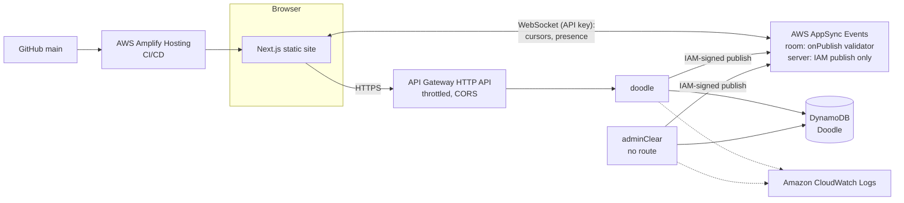

# Live Portfolio

My portfolio, built for the AWS Student Builder Challenge: Build Your Tech Superpower.

The page is multiplayer: you can see the other people reading it, and leave a mark that everyone sees.

## The creative feature: "You're not alone here"

| Feature | What it does |
|---|---|
| **Live cursors + presence** | Every visitor gets an anonymous name and colour ("Amber Eel") and a labelled cursor that lands on the same card on any screen size. Phone visitors appear as a pill that follows their scrolling. |
| **Live count** | The hero badge reads "You + 2 swimming here", and the nav bubble rises while others are around. |
| **Dock** | Everyone here as sea creatures (🦈 🐙 🐢), a "+N" list of the whole room, Invite (copy link), and two settings: **Go invisible** and **Hide others' cursors**. |
| **Edge indicators** | People scrolled above or below you show as coloured pills at the screen edge; click one to jump to them. |
| **Pixel guestbook** | A shared 32 × 32 canvas. Every pixel is confirmed by the server and appears live for everyone. Paintable by mouse, touch or keyboard, with a small ink budget. |
| **The sea reacts** | Sharks and fish in the ASCII sea react to everyone's cursors, not just yours. |

**Why this feature?** Prodpod, my study platform, taught me that people stay where other people are. A portfolio is usually a lonely page, so I made this one a room.

## Architecture



| AWS service | What it does here |
|---|---|
| **AWS Amplify Hosting** | Builds every push to `main`, deploys the backend, and serves the static site from a CDN |
| **AWS Amplify Gen 2** | Defines the whole backend in TypeScript ([`amplify/backend.ts`](amplify/backend.ts)) and deploys it with CDK |
| **AWS AppSync Events** | WebSocket pub/sub. Namespace `room` carries visitors' cursors and presence through an `onPublish` validator; namespace `server` carries confirmed guestbook pixels and accepts **IAM publishes only** |
| **Amazon API Gateway (HTTP API)** | `GET/POST /doodle`, with stage throttling (burst 20, 10 req/s) and CORS limited to the site |
| **AWS Lambda** | Two small Node.js functions: paint a pixel and broadcast it, reset the guestbook |
| **Amazon DynamoDB** | `Doodle` (one item; each pixel is an atomic `SET cells[i]`) |
| **Amazon CloudWatch** | Lambda logs and API metrics |
| **AWS Budgets** | A $5/month budget with email alerts at 50%, 80% and 100% of actual spend and 100% of forecast |

### Design decisions

- **Clients can't fake a pixel.** A browser only *requests* a pixel (`POST /doodle`). The Lambda writes it to DynamoDB and then publishes the confirmed change, signed with its IAM role, to `/server/main`. An `onPublish` handler can't tell an API-key publish from an IAM one, so the split is made by auth mode on a namespace of its own: browsers can subscribe to `server` but get a **401** if they try to publish there (tested).
- **Validation at the edge.** The `room` namespace's [`onPublish` handler](amplify/events/room-onPublish.js) (APPSYNC_JS) drops any event with an unknown type, coordinates outside 0..1, a malformed id, a colour outside the palette, or a payload over 1 KB. The client re-checks what it receives and ignores any visitor sending more than 30 events a second.
- **HTTP API, not Lambda Function URLs.** One base URL, CORS in one place, and stage-level throttling, which Function URLs don't have. At this scale it costs next to nothing (the first million requests a month are free for 12 months, then $1 per million).
- **Anchor-based coordinates.** A cursor is sent as "x/y inside this card" (`[data-anchor]`), not as pixels, so it lands on the same card on a phone and a widescreen even though the grid reflows.
- **Only real people count.** A tab listens straight away but joins (and is counted) only after its first real input, which keeps crawlers, Lighthouse and untouched tabs out of the count.
- **No admin endpoint.** Resetting the guestbook is a Lambda with no HTTP route, invoked with AWS credentials ([`scripts/clear-guestbook.mjs`](scripts/clear-guestbook.mjs)), so there is no admin token to leak.
- **Privacy.** Visitors are anonymous, and cursors are relayed live but never stored.

## Tech stack

- **Frontend:** Next.js 16 (App Router, static export) · React 19 · TypeScript · Tailwind CSS 4 · shadcn/ui (Radix)
- **Backend:** AWS Amplify Gen 2 · AppSync Events · API Gateway · Lambda (Node.js) · DynamoDB · region `eu-west-2` (London)

## Run it locally

Requires Node.js 22 and AWS credentials for the Amplify sandbox.

```bash
npm install
npx ampx sandbox      # deploys a personal cloud backend and writes amplify_outputs.json
npm run dev           # http://localhost:3000
```

Without the sandbox, the site still works as a normal static portfolio: the multiplayer layer stays hidden and the guestbook shows its starting drawing. (`npm run dev` and `npm run build` write a stub `amplify_outputs.json` when there isn't one.)

On Node 25, `ampx` crashes on Node's built-in `localStorage`; run it as `NODE_OPTIONS=--no-webstorage npx ampx sandbox`, or use Node 22 like the pipeline.

**Testing multiplayer:** open two desktop tabs, plus a phone on the same network at `http://<your-lan-ip>:3000`. A tab joins the room on its first scroll, key press or mouse move.

**Scripts:**
- `node scripts/check-onpublish.mjs` publishes good and bad events to the deployed room and checks that only the good ones get through.
- `node scripts/clear-guestbook.mjs` resets the guestbook to its starting drawing for everyone.

To check the production build: `npm run build` (writes the static site to `out/`).

### API key rotation

The browser uses a public AppSync API key (public by design: the `onPublish` validator and a client-side flood guard limit what it can do). AppSync caps API keys at **365 days**. The expiry is recomputed on every deploy, so each push to `main` extends it to a year from then. If the site goes a year without a deploy, redeploy (or extend the key in the AppSync console) and the key keeps working.

## Deployment

Amplify Hosting is connected to this repo's `main` branch. [`amplify.yml`](amplify.yml) runs two stages:

1. **Backend:** `npx ampx pipeline-deploy` deploys `amplify/` and generates `amplify_outputs.json`.
2. **Frontend:** `npm run build` creates the static export in `out/`.

CORS on the HTTP API allows the branch's own `amplifyapp.com` domain (from the `AWS_APP_ID` and `AWS_BRANCH` the pipeline provides) and `localhost:3000`; add a custom domain with the `EXTRA_ALLOWED_ORIGINS` environment variable (comma-separated). A personal sandbox allows any origin so phones on the LAN can test against it.

## Cost

Serverless only (no EC2, ECS or RDS), all pay-per-request: AppSync Events, API Gateway, Lambda and on-demand DynamoDB cost nothing while idle and fractions of a cent per visit. API Gateway throttling and the `onPublish` validator cap what abuse can cost. An AWS Budgets alarm ($5/month; alerts at 50%, 80%, 100% actual and 100% forecast) catches anything unexpected.

## Project structure

```
amplify/
  backend.ts            Events API, HTTP API, tables, IAM grants, CORS, outputs
  events/               room-onPublish.js (APPSYNC_JS validator)
  functions/            doodle, admin-clear
  shared/               HTTP helpers, guestbook storage, IAM-signed publish
src/app/                Next.js layout, page, global styles, icon.svg (favicon)
src/components/
  sections/             Hero, About, Projects, Guestbook, Contact
  layout/               nav, footer, section intro, scroll-reveal observer
  sea/                  AsciiSea (canvas), AsciiScene (card art), FishSchool, SeaDecor
  hero/                 InlineShark
  multiplayer/          room provider, cursor layer, edge indicators, dock, live badge
  guestbook/            live canvas, palette picker
  ui/                   shadcn/ui components, restyled
src/lib/realtime/       protocol types, connection + backoff, identity, anchors, presence, cursors
src/lib/api.ts          HTTP API client (retries on throttling)
src/lib/content.ts      all copy in one place
src/lib/guestbook.ts    grid size, palette and seed art (shared with the Lambdas)
scripts/                outputs stub, onPublish check, guestbook reset
```

## Design

**"Shallows":** white pages, with a sunlit teal lagoon (the hero and the contact panel) where visitors meet. Everything in the water is **ASCII characters drawn on a canvas, and it reacts to the people on the page** ([AsciiSea.tsx](src/components/sea/AsciiSea.tsx), no libraries; inspired by [ascii-sharks](https://github.com/stackedlol/ascii-sharks), with original code and art):

- **Caustics:** a slowly shifting web of light on the water (a warped Voronoi pattern), strongest near the surface.
- **Sharks:** each one is drawn by a shading function rather than fixed art, so it bends as it swims and turns in 3D. Depth sets each shark's size, opacity and parallax. Sharks are **curious**: they drift towards a cursor that holds still and dart away from one that moves fast. Clicking a shark startles it and releases a burst of bubbles.
- **Fish and bubbles:** a small school of `><>` fish (boids) that scatters from cursors and sharks, and bubbles that grow as they rise and pop near the surface.
- **Ripples:** every cursor, yours and other visitors', ripples the water. The waterline at the bottom of the hero rocks with it, and foam fizzes where the sea meets the page.

Around the sea:

- **Colour:** one teal ramp, deep teal at the surface fading through pale aqua to white, tuned so white text on it still passes contrast.
- **Buttons:** glass pills, white glass on the sea and teal glass on white, that grow slightly on hover. Nav links roll on hover.
- **About:** a fact grid with hairlines only between cells, no boxes. Each cell has a depth reading (−08 m … −40 m, deeper as you go) and a small looping ASCII scene: a shark, rising bubbles, a fish school, a jellyfish, kelp with a sonar ping. Scenes only animate while on screen.
- **Small touches:** `><>` fish drifting above section labels, bubble bullets, and a bubble logomark beside the name (also the favicon).
- **Performance:** the canvas runs at no more than 30 fps, pauses off-screen or in a hidden tab, and shows one still frame under `prefers-reduced-motion`. Phones get one shark and coarser cells. The CSS gradient paints first, so the canvas never delays the first paint.
- **Accessibility:** a skip link, visible focus rings, keyboard access everywhere, reduced-motion fallbacks (the sea, card scenes, drifting fish and button motion all hold still), and a mask that keeps glyphs out from behind text. All ASCII art is decorative and hidden from screen readers.

## Challenges & what I learned

- **Relative coordinates.** Pixel positions are meaningless across screen sizes, so cursors travel as "x/y inside this card". Each receiver resolves the card on its own layout every frame. Measured end to end, a cursor lands within a pixel of where the other tab pointed.
- **Trusting the server, not the client.** The public API key means anyone can publish to the room, so every event goes through a validator, and anything that must be authoritative (guestbook pixels) is published only by a Lambda using IAM, on a namespace browsers can't publish to.
- **Testing a validator without deploying it.** I tested the APPSYNC_JS handler against AppSync's real runtime with the `EvaluateCode` API before it ever ran. The runtime has no regex literals, no `try/catch` and no `++`.
- **Performance budget.** Adding the multiplayer layer first dropped Lighthouse performance from about 90 to the 70s and 80s: the Amplify client was downloading during page load and delaying the animated hero. Connecting only after the page has loaded and the browser is idle, and lazy-loading the dock and cursor layers, brought it back without anyone noticing the extra half-second.
- **Reconnects.** WebSockets drop. The client retries with exponential backoff (1 s to 30 s, full jitter), hides all multiplayer UI while offline so the page is just a portfolio, and on reconnect re-announces itself and refetches the guestbook in case it missed a pixel.
- **New-account limits.** Load testing hit a Lambda concurrency limit of 10 (the default for new AWS accounts) and API Gateway answered 429. Reads now retry with jittered backoff, and painting undoes its optimistic pixel if the server refuses it.
- **Moderating anonymous input.** Rate limits at API Gateway, length and range caps in the validator and Lambdas, an ink budget on the guestbook, and a client flood guard.
