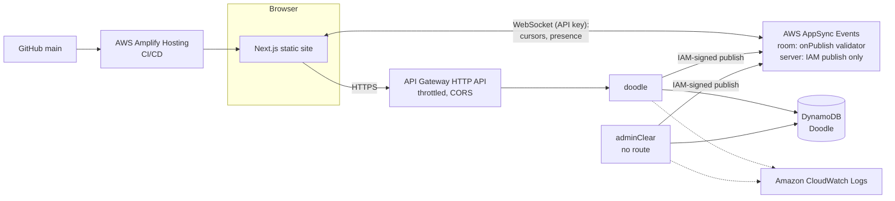

# Live Portfolio

My portfolio, built for the AWS Student Builder Challenge: Build Your Tech Superpower.

The page is multiplayer: you can see the other people reading it, and leave a mark that everyone sees.

[Demo](https://github.com/user-attachments/assets/f4eecf2d-5e85-4512-a89c-a4455a419450)

[Link to portfolio](https://wendyji.com)

## The creative feature: "You're not alone here"

A portfolio is usually a lonely page, so I made this one a room.

- **Live cursors and presence:** every visitor gets an anonymous name ("Amber Eel") and a labelled cursor that lands on the same card on any screen size. The hero badge counts who's here ("You + 2 swimming here").
- **Dock and edge pills:** everyone in the room as sea creatures, plus **Invite**, **Go invisible** and **Hide others' cursors**. People scrolled elsewhere show as pills at the screen edge; click one to jump to them.
- **Pixel guestbook:** a shared 32 × 32 canvas. Every pixel is confirmed by the server and appears live for everyone.
- **The sea reacts:** the ASCII sharks, fish and ripples respond to everyone's cursors, not just yours.

## Architecture



| AWS service | Role |
|---|---|
| **Amplify Hosting + Gen 2** | Builds and deploys every push to `main`; the backend is defined in TypeScript ([`amplify/backend.ts`](amplify/backend.ts)) |
| **AppSync Events** | WebSocket pub/sub: `room` (cursors, presence, through an `onPublish` validator) and `server` (confirmed pixels, **IAM publishes only**) |
| **API Gateway (HTTP API)** | `GET/POST /doodle`, throttled (burst 20, 10 req/s), CORS limited to the site |
| **Lambda** | Paint a pixel and broadcast it; reset the guestbook |
| **DynamoDB** | One `Doodle` item; each pixel is an atomic `SET cells[i]` |
| **CloudWatch, Budgets** | Logs and metrics; a $5/month budget with email alerts |

### Design decisions

- **Clients can't fake a pixel.** The browser only requests a pixel; a Lambda writes it, then publishes the confirmed change with its IAM role. Browsers get a 401 if they try to publish to `server`.
- **Validation at the edge.** The [`onPublish` handler](amplify/events/room-onPublish.js) drops unknown types, out-of-range coordinates, bad ids or colours, and payloads over 1 KB. The client also ignores any visitor who floods the room.
- **Cursors are relative to cards** (`[data-anchor]`), not pixels, so they land on the same card on a phone and a widescreen.
- **Only real people count.** A tab joins the room only after its first real input, which keeps crawlers and idle tabs out of the count.
- **No admin endpoint.** The guestbook reset is a Lambda with no HTTP route, so there's no admin token to leak.
- **Privacy.** Visitors are anonymous; cursors are relayed live and never stored.

## Tech stack

- **Frontend:** Next.js 16 (static export), React 19, TypeScript, Tailwind CSS 4, shadcn/ui
- **Backend:** AWS Amplify Gen 2, AppSync Events, API Gateway, Lambda (Node.js), DynamoDB, `eu-west-2` (London)

## Run it locally

Requires Node.js 22 and AWS credentials.

```bash
npm install
npx ampx sandbox      # deploys a personal backend and writes amplify_outputs.json
npm run dev           # http://localhost:3000
```

Without the sandbox, the site works as a plain portfolio (no multiplayer). To test multiplayer, open two tabs; a tab joins on its first scroll, key press or mouse move.

**Scripts:** `npm run check:contrast` (WCAG check of every colour pair, both themes) · `node scripts/check-onpublish.mjs` (validator test) · `node scripts/clear-guestbook.mjs` (reset the guestbook) · `node scripts/gen-ascii-creatures.mjs` (regenerate the ASCII creatures).

## Deployment and cost

Amplify Hosting deploys `main` through [`amplify.yml`](amplify.yml): the backend (`npx ampx pipeline-deploy`), then the static frontend (`npm run build`). Everything is serverless and pay-per-request, so it costs nothing while idle; throttling and the validator cap what abuse can cost.

The browser's AppSync API key is public by design and expires after 365 days; every deploy extends it.

## Design: "the dive"

Scrolling the page is a dive, from a sunlit lagoon to the seabed: Hero (surface), About (sunlight zone), Projects (twilight), Guestbook (midnight), Contact (seabed, ~4,200 m). A sounding line down the left edge shows the live depth.

- **The hero sea** ([AsciiSea.tsx](src/components/sea/AsciiSea.tsx)) is a canvas of ASCII caustics, sharks, fish and bubbles. The sharks are curious: they drift towards a cursor that holds still and dart from one that moves fast.
- **Creatures** are generated from smooth shapes ([`gen-ascii-creatures.mjs`](scripts/gen-ascii-creatures.mjs)): a leaping dolphin in About, a pufferfish that puffs up on hover in Projects, an anglerfish in the Guestbook, and a seabed with kelp and a crab in Contact.
- **Night dive:** a dark mode with glowing creatures. The switch is an ASCII dissolve, and an inline script sets the theme before first paint, so it never flashes.
- **Performance:** the sea canvases cap at 30 fps, pause off screen, and lower their own quality only when they can't keep up. On a 4× throttled CPU this halved the hero's frame time; unthrottled, it holds 60 fps.
- **Accessibility:** keyboard access everywhere, reduced-motion fallbacks for every animation, and decorative art hidden from screen readers.

## Challenges and what I learned

- **Trusting the server, not the client.** With a public API key anyone can publish, so every event is validated, and authoritative data (pixels) is published only by a Lambda using IAM.
- **Testing a validator before deploying it.** I ran the APPSYNC_JS handler against AppSync's real runtime with `EvaluateCode` (no regex literals, no `try/catch`, no `++`).
- **Performance budget.** Loading multiplayer during page load dropped Lighthouse from ~90 to the 70s. Connecting only once the browser is idle brought it back.
- **Reconnects and limits.** The client retries with jittered backoff and resyncs after reconnecting. Load testing hit a new account's Lambda concurrency limit, so reads now retry and failed paints are undone.
- **A burst isn't a flood.** A tab that stalls for a moment receives a backlog of cursor events at once. A token bucket instead of a per-second count stopped honest visitors being muted.
- **Contrast on tinted water.** Checking text only against white hid failures; a script that checks every pair against every zone, in both themes, caught them.
