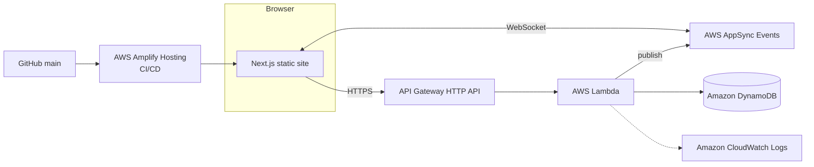

# Live Portfolio

My portfolio built for the **AWS Student Builder Challenge: Build Your Tech Superpower**.

The page is **multiplayer**: you can see the other people who are reading it. 

> 🚧 Work in progress. Sections marked _(Phase n)_ are planned and not built yet.

### What's built (Phase 1)

- The full single-page portfolio: **Hero → About → Projects → Guestbook → Contact**, as a static export.
- The interactive ASCII sea in the hero and the contact panel (sharks, fish, bubbles and ripples that react to your cursor).
- The Amplify Hosting pipeline, with an empty Amplify Gen 2 backend so the deployment runs end to end.
- The guestbook shows its seed art and colour palette; painting opens in Phase 5.

## The creative feature: "You're not alone here"

| Feature | What it does | Status |
|---|---|---|
| Live cursors + presence | Every visitor gets an anonymous name and colour ("Teal Otter") and a labelled cursor | _(Phase 2)_ |
| Reactions | 👋 🔥 🎉 💡 bursts that everyone sees | _(Phase 3)_ |
| Cursor chat | Press `/` to say something short; it fades after ~4 s and is never stored | _(Phase 3)_ |
| Ghost replays | When you're alone, a few earlier visitors' cursor paths replay as translucent "ghosts" | _(Phase 4)_ |
| Pixel guestbook | A shared 32 × 32 canvas; every pixel you place appears live for everyone | _(Phase 5)_ |

**Why this feature?** _(to write)_ A portfolio is usually a lonely page, so I made this one a room.

## Architecture



| AWS service | What it does here |
|---|---|
| **AWS Amplify Hosting** | Builds every push to `main` and serves the static site from a CDN |
| **AWS Amplify Gen 2** | Defines the backend in TypeScript (`amplify/`) and deploys it with CDK |
| **AWS AppSync Events** | WebSocket pub/sub for cursors, presence, reactions and chat _(Phase 2)_ |
| **Amazon API Gateway (HTTP API)** | Rate-limited HTTPS endpoints for ghosts and the guestbook _(Phase 4)_ |
| **AWS Lambda** | Validates input and reads/writes state _(Phase 4)_ |
| **Amazon DynamoDB** | Ghost paths (7-day TTL) and the guestbook grid _(Phase 4–5)_ |
| **Amazon CloudWatch** | Lambda logs (automatic) |
| **AWS Budgets** | Billing alarm to keep costs near zero _(Phase 6)_ |

## Tech stack

- **Frontend:** Next.js 16 (App Router, static export) · React 19 · TypeScript · Tailwind CSS 4 · shadcn/ui (Radix)
- **Backend:** AWS Amplify Gen 2 · region `eu-west-2` (London)

## Run it locally

Requires Node.js 20+ and AWS credentials configured for the Amplify sandbox.

```bash
npm install
npx ampx sandbox      # deploys a personal cloud backend and writes amplify_outputs.json
npm run dev           # http://localhost:3000
```

Without the sandbox, the site still works as a normal static portfolio; the multiplayer layer stays hidden.

To check the production build: `npm run build` (writes the static site to `out/`).

## Deployment

Amplify Hosting is connected to this repo's `main` branch. [`amplify.yml`](amplify.yml) runs two phases:

1. **Backend:** `npx ampx pipeline-deploy` deploys `amplify/` and generates `amplify_outputs.json`.
2. **Frontend:** `npm run build` creates the static export in `out/`.

No secrets are committed. `amplify_outputs.json` is gitignored and generated in the pipeline.

## Project structure

```
amplify/                backend (Amplify Gen 2; empty until Phase 2)
src/app/                Next.js layout, page, global styles, icon.svg (favicon)
src/components/
  sections/             Hero, About, Projects, Guestbook, Contact
  layout/               nav, footer, section intro, scroll-reveal observer
  sea/                  AsciiSea (canvas), AsciiScene (card art), FishSchool, SeaDecor
  hero/                 HeroGrid (guide lines), InlineShark
  ui/                   shadcn/ui components, restyled
src/lib/content.ts      all portfolio copy in one place
src/lib/ascii-scenes.ts frames for the About cards' ASCII art
src/lib/guestbook.ts    guestbook grid size, palette and seed art (shared with the backend)
.plans/                 design specs, one per design pass
```

## Design

**"Shallows":** white pages, with a sunlit teal lagoon (the hero and the contact panel) where visitors meet. Everything in the water is **ASCII characters drawn on a canvas, and it reacts to the people on the page** ([AsciiSea.tsx](src/components/sea/AsciiSea.tsx), no libraries; inspired by [ascii-sharks](https://github.com/stackedlol/ascii-sharks), with original code and art):

- **Caustics:** a slowly shifting web of light on the water (a warped Voronoi pattern), strongest near the surface.
- **Sharks:** each one is drawn by a shading function rather than fixed art, so it bends as it swims and turns in 3D. Depth sets each shark's size, opacity and parallax. Sharks are **curious**: they drift towards a cursor that holds still and dart away from one that moves fast. Clicking a shark startles it and releases a burst of bubbles.
- **Fish and bubbles:** a small school of `><>` fish (boids) that scatters from cursors and sharks, and bubbles that grow as they rise and pop near the surface.
- **Ripples:** every cursor, yours and other visitors', ripples the water. The waterline at the bottom of the hero rocks with it, and foam fizzes where the sea meets the page.

Around the sea:

- **Colour:** one teal ramp, deep teal at the surface fading through pale aqua to white, tuned so white text on it still passes contrast.
- **Buttons:** glass pills, white glass on the sea and teal glass on white, that grow slightly on hover. Nav links roll on hover.
- **About:** a fact grid with hairlines only between cells, no boxes. Each cell has a depth reading (−08 m … −40 m, deeper as you go) and a small looping ASCII scene: a shark, rising bubbles, a fish school, a jellyfish, kelp with a sonar ping. Scenes only animate while on screen.
- **Small touches:** `><>` fish drifting above section labels, bubble bullets, and a bubble logomark beside the name (also the favicon).
- **References:** the hero and buttons follow [DayDream](https://thedaydream.studio/) and the fact grid follows [Linear](https://linear.app/), with the hue and motifs moved under the sea.
- **Type:** Aspekta (SIL OFL, self-hosted variable font), with Geist Mono for `[01] · LABELS`.
- **Components:** shadcn/ui on Radix, restyled: pill buttons, bracket badges, swatch toggles, and a glass Sheet for the mobile menu.
- **Performance:** the canvas runs at no more than 30 fps, pauses off-screen or in a hidden tab, and shows one still frame under `prefers-reduced-motion`. Phones get one shark and coarser cells. The CSS gradient paints first, so the canvas never delays the first paint.
- **Accessibility:** a skip link, visible focus rings, keyboard access everywhere, reduced-motion fallbacks (the sea, card scenes, drifting fish and button motion all hold still), and a mask that keeps glyphs out from behind text. All ASCII art is decorative and hidden from screen readers.

## Challenges & what I learned

_(to write as the build progresses)_

- **Relative coordinates:** making a cursor point at the same card on a phone and on a widescreen monitor.
- **The empty-room problem:** a multiplayer page with nobody else on it is a sad page. Ghost replays are the fix.
- **Reconnects:** WebSockets drop; the page has to recover quietly.
- **Cost control:** serverless only, with a budget alarm.
- **Moderating anonymous input:** rate limits, length caps and validation at the edge.
